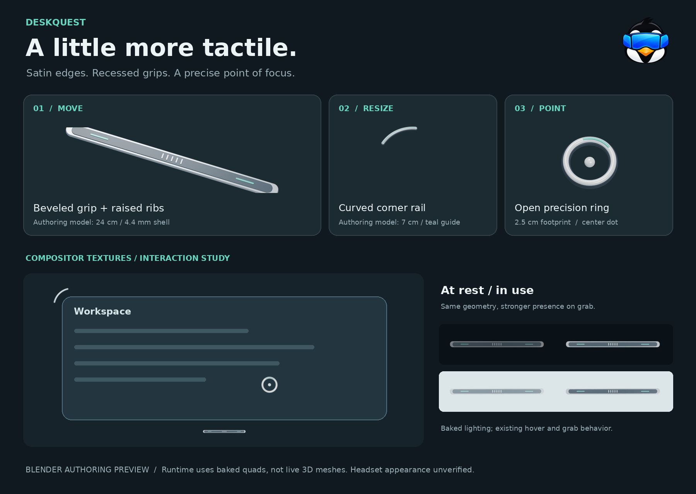

# Spatial controls

Three original Blender models give DeskQuest's existing controls a consistent
satin-metal finish, soft edges and restrained teal inlays:

* **Grip:** a beveled shell, recessed face, five raised ribs and two inlays.
* **Resize corner:** a curved rail with a graphite underside and teal guide.
* **Pointer:** an open porcelain ring and small center dot. The gap around the
  dot keeps the desktop target visible.



## Source assets

`spatial-controls.blend` contains all three models in named collections, with
editable materials and studio lights. Each standalone `.glb` exports its model
at the origin in meters, with glTF's Y-up orientation. Blender models face +Z,
with X right and Y up before the exporter's coordinate conversion.

`renders/*-model.png` are oblique views of the actual geometry. `renders/grip.png`,
`corner.png` and `cursor.png` are front orthographic bakes. `manifest.json` records
dimensions, source triangle counts and SHA-256 hashes of the runtime bytes.
These are authoring previews, not headset captures.

## Runtime integration

The Rust OpenXR client embeds the bakes from
`crates/client/assets/spatial-controls/*.rgba` at compile time. It uses its existing
quad layers, handle reveal zones, corner rotations, screen transforms and cached
idle/active swapchains. A mesh renderer and glTF dependency are not required.
Lighting is baked, so these controls do not have dynamic lighting or stereoscopic
mesh depth in the headset. The full 3D sources remain available for future use.

| Control | Texture | Authoring footprint |
| --- | --- | --- |
| Grip | 384 × 32 | 24 × 2 cm |
| Corner | 128 × 128 | 7 × 7 cm |
| Cursor | 96 × 96 | 2.5 × 2.5 cm |

The grip and corner scale with the screen at runtime (14% and 11.6% of its
width). The corner rail stays concentric with the rounded screen corner. The
cursor keeps its 2.5 cm footprint.

The raw sources occupy 148 KiB. Cached CPU textures for two handle states and one
cursor occupy 260 KiB, excluding the unchanged ray. The existing upload-once
behavior and layer count are retained. No rendering-performance claim is made
without measuring on a headset.

Source bytes are top-down, straight-alpha RGBA8. `overlay.rs` scales opacity and
premultiplies RGB once while preparing each cached texture, matching the existing
OpenXR layer flags. Procedural ray and frame textures follow the same alpha
contract. Idle handles use 0.60 opacity; manipulation uses 0.95.

## Rebuild and check

From the repository root, using Blender 5.2 and Python with Pillow:

```sh
blender --background --threads 8 --python art/spatial-controls/build.py
python3 art/spatial-controls/pack.py
cargo test -p linux-quest-client
cargo clippy -p linux-quest-client --all-targets -- -D warnings
```

Build the installable Quest APK with the existing Android SDK/NDK setup:

```sh
CARGO_TARGET_DIR="$PWD/target/spatial-controls-android" bash crates/client/android/build.sh --release
```

This uses a fresh native build directory, avoiding stale CMake paths after a
checkout move. The packaging script honors that directory and supplies the
compatibility setting needed by bundled Opus on CMake 4. The signed APK is
`crates/client/target/android-apk/linux-quest-release.apk`; the RGBA bytes are embedded
in `liblinux_quest_client.so`, so there are no external texture files to install.

Rebuilding replaces only this asset set and its runtime bakes. Blender itself is
not needed to compile the app. The texture tests check dimensions, premultiplied
edges, cursor coverage and opacity states alongside the existing spatial tests.

Before a release, check on an awake Quest: pointer legibility over light and dark
desktops, reveal/hide behavior, moving and resizing all four corners on flat and
curved screens, and alpha edges over passthrough. Desktop tests and Blender
renders do not establish headset appearance or frame timing.

## Branding

The Quest launcher uses the existing penguin with the blue VR visor, copied from
`packaging/icons/hicolor/512x512/apps/org.linuxquest.Desktop.png`. The desktop and
tray logo assets remain unchanged.
